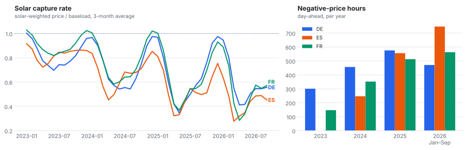
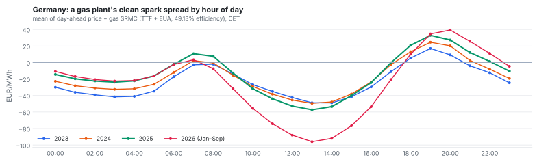
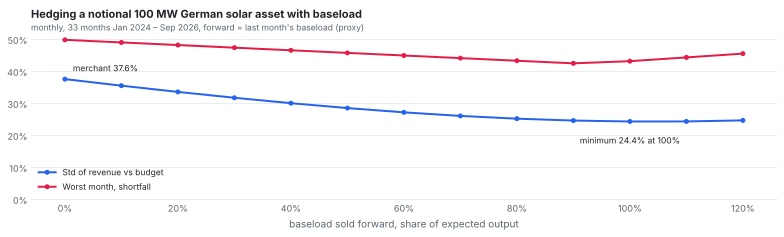
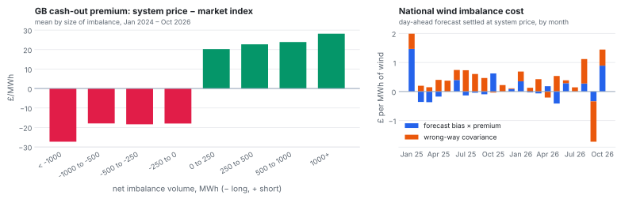
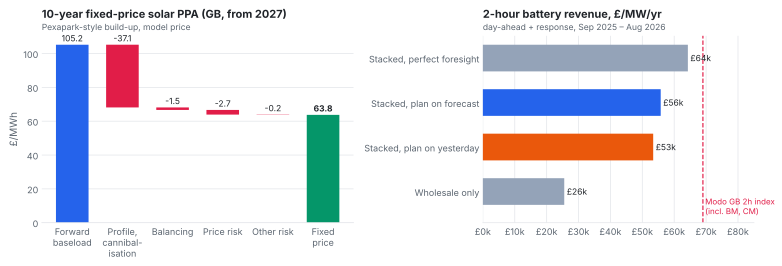
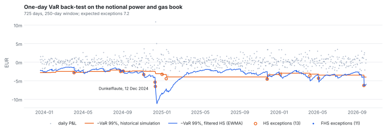
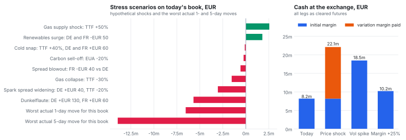

# European power fundamentals, GB deal pricing and market risk

Hourly day-ahead power prices, load and renewable output for Germany, Spain, France and
Great Britain, joined to TTF gas, EU carbon, GB balancing and ancillary-service data, all
public. Five modules answer the questions a power and gas desk asks:

1. **Fundamentals** – how much of the baseload price solar and wind capture, how often prices go negative, where gas sets the price, what a gas plant earns.
2. **Hedging** – how much baseload a solar asset owner should sell forward, and what that leaves unhedged.
3. **GB balancing** – what the cash-out price adds over the traded market, and what a day-ahead wind forecast error costs.
4. **GB deal pricing** – a solar balancing fee, a fixed-price solar PPA, a battery floor and toll, and the two in one book.
5. **Market risk** – VaR and ES with input checks and back-testing, stress scenarios, loss limits and exchange margin for a power and gas book.

Personal build, public data only. Built with AI coding agents (Claude Code). 48 pytest tests.

## Results at a glance

| Module | Headline |
|---|---|
| Fundamentals | German solar capture rate fell from **0.76** (2023) to **0.52** (2025); Spain went from **0** negative-price hours in 2023 to **747** in Jan–Sep 2026 |
| Hedging | Selling **100%** of expected solar output as baseload cuts revenue-vs-budget volatility from **37.6%** to **24.4%**; shape risk, which baseload cannot hedge, is 48–56% of the variance |
| GB balancing | The cash-out price averages about **£20/MWh** above the market index when the system is short and **£18** below when long; national wind imbalance costs **£0.36/MWh** |
| GB deal pricing | Solar balancing fee **£1.58/MWh**; 10-year fixed-price solar PPA **£63.8/MWh** (model); a 2-hour battery planned on a day-ahead forecast earns **87%** of perfect foresight; 5-year toll **£49,700/MW/yr** |
| Market risk | On a sold clean spark spread plus a DE–FR spread, historical-simulation VaR has **13** exceptions in 725 days (7.2 expected); EWMA-filtered HS brings it to **11** and the last 250 days back to the green zone |

<picture>
  <source media="(prefers-color-scheme: dark)" srcset="docs/img/capture-dark.svg">
  
</picture>

**Contents:** [Data](#data) · [1. Fundamentals](#1-fundamentals-de-es-fr) · [2. Hedging a solar asset](#2-hedging-a-solar-asset-with-baseload) · [3. GB balancing](#3-gb-balancing-and-wind-imbalance) · [4. GB deal pricing](#4-gb-deal-pricing-solar-ppas-and-battery-floors-and-tolls) · [5. Market risk](#5-market-risk-var-stress-limits-and-margin) · [Caveats](#caveats) · [Run](#run)

## Data

| Series | Source | Window |
|---|---|---|
| Day-ahead price, load, residual load, solar, wind, gas generation (DE-LU, ES, FR) | [Energy-Charts API](https://api.energy-charts.info) (Fraunhofer ISE; ENTSO-E / SMARD), CC BY 4.0. 15-minute data averaged to hourly, CET | Jan 2023 – Sep 2026 |
| TTF front month (EUR/MWh) | Yahoo Finance `TTF=F`, daily close | Jan 2023 – Sep 2026 |
| EUA (EUR/t) | Yahoo Finance `CO2.L` (SparkChange physical EUA ETC), a daily proxy that tracks spot EUA less fees | Jan 2023 – Sep 2026 |
| GB system price, net imbalance volume, market index (MID), wind and solar outturn and day-ahead forecasts | Elexon BMRS (DISEBSP, MID, AGWS, DGWS), half-hourly | Jan 2024 – Oct 2026 |
| GB day-ahead hourly auction price (N2EX) | [NESO data portal](https://www.neso.energy/data-portal/day-ahead-power-exchange-prices-nordpool), Nord Pool prices republished under the EU transparency rules | Oct 2021 – Oct 2026 |
| GB national solar output and installed capacity | [PV_Live](https://www.solar.sheffield.ac.uk/pvlive/), Sheffield Solar | Oct 2021 – Oct 2026 |
| DC / DM / DR clearing prices per EFA block | [NESO](https://www.neso.energy/data-portal/eac-auction-results), EAC results summary, OGL | Nov 2023 – Oct 2026 |
| Forward anchor: winter 2026/27 Baseload Market Reference Price | [Low Carbon Contracts Company](https://www.lowcarboncontracts.uk/data-portal/dataset/forecast-market-reference-prices), OGL | published Nov 2026 |

Contains BMRS data © Elexon Limited copyright and database right 2026
([licence](https://www.elexon.co.uk/bsc/data/balancing-mechanism-reporting-agent/copyright-licence-bmrs-data/)).

## 1. Fundamentals (DE, ES, FR)

**Method.**
- **Capture rate** = generation-weighted average price ÷ time-weighted (baseload) price.
- **Gas SRMC** (CCGT short-run marginal cost) = (TTF + 0.202 × EUA) ÷ 0.4913, the standard clean-spark-spread convention (49.13% efficiency, 0.202 tCO2 per MWh of gas).
- **Clean spark spread** = baseload price − gas SRMC.
- **Gas near the margin** = share of hours with price within ±15% of gas SRMC. A rough proxy only.
- **Price regression**: hourly OLS of price on gas SRMC and residual load (GW), by market and year, with HAC (Newey-West, 24 lags) errors.

**Results** (2026 = January to September):

| Market | Year | Baseload (EUR/MWh) | Solar capture rate | Wind capture rate | Negative-price hours | Regression R² | +1 GW residual load (EUR/MWh) |
|---|---|---|---|---|---|---|---|
| DE | 2023 | 95.2 | 0.76 | 0.84 | 301 | 0.77 | +3.0 |
| DE | 2024 | 78.5 | 0.59 | 0.84 | 457 | 0.66 | +3.1 |
| DE | 2025 | 89.3 | 0.52 | 0.88 | 576 | 0.77 | +3.1 |
| DE | 2026 | 107.7 | 0.53 | 0.90 | 471 | 0.73 | +3.4 |
| ES | 2023 | 87.1 | 0.84 | 0.87 | 0 | 0.59 | +5.0 |
| ES | 2024 | 63.0 | 0.67 | 0.88 | 247 | 0.76 | +4.7 |
| ES | 2025 | 65.3 | 0.55 | 0.97 | 556 | 0.72 | +5.6 |
| ES | 2026 | 74.1 | 0.52 | 0.92 | 747 | 0.77 | +6.5 |
| FR | 2023 | 96.9 | 0.86 | 0.89 | 147 | 0.54 | +3.0 |
| FR | 2024 | 58.0 | 0.68 | 0.90 | 352 | 0.60 | +2.9 |
| FR | 2025 | 61.1 | 0.59 | 0.90 | 513 | 0.66 | +3.2 |
| FR | 2026 | 81.5 | 0.55 | 0.90 | 563 | 0.53 | +4.5 |

Full table: `output/yearly_fundamentals.csv`; regressions: `output/price_regression.json`.

- **Solar cannibalisation.** The German solar capture rate fell from 0.76 in 2023 to 0.52 in 2025, and Spain's from 0.84 to 0.55. A pay-as-produced solar PPA priced off baseload now earns roughly half of it.
- **Negative prices spread south.** Spain had no negative hour in 2023 and 747 in the first nine months of 2026.
- **Wind holds up.** Wind capture rates stay at 0.84 to 0.97, because wind output is less concentrated in the cheapest hours than solar.
- **Merit order.** Residual load and gas SRMC explain 53% to 77% of hourly price variance. In Germany each extra GW of residual load adds about EUR 3/MWh, and the curve steepens sharply above about 45 GW (`output/de_merit_order_q3_2026.png`).
- **Gas plant economics follow a duck curve.** The German clean spark spread averages negative in both baseload and the 08:00–20:00 weekday peak block, because solar depresses the midday hours (2025 mean at 13:00: EUR −57/MWh). A standard CCGT earns in the morning and evening ramps instead (2025 mean at 19:00: EUR +33/MWh): the spread was positive in 37% of 2025 hours, averaging EUR +28/MWh in those hours.

<picture>
  <source media="(prefers-color-scheme: dark)" srcset="docs/img/spark-spread-dark.svg">
  
</picture>

## 2. Hedging a solar asset with baseload

`powerfund/hedge.py` backtests a notional 100 MW German solar asset (hourly output = national solar output ÷ installed AC capacity, from Energy-Charts) over the 33 months January 2024 – September 2026. Each month the owner sells a baseload forward for h × expected output and is judged on revenue versus a budget set at the start of the month:

- expected output = same month last year's capacity factor × capacity × hours;
- forward price = last month's realised baseload average (proxy: there is no free history of EEX month futures);
- expected capture rate = same month last year's;
- budget = expected output × forward × expected capture rate.

| Hedge (share of expected volume) | Revenue vs budget, std | Worst month |
|---|---|---|
| 0% (merchant) | 37.6% | −49.9% |
| 70% | 26.1% | −44.2% |
| **100%** | **24.4%** | −43.2% |
| Capture-weighted (≈72%) | 29.2% | −44.9% |

<picture>
  <source media="(prefers-color-scheme: dark)" srcset="docs/img/hedge-dark.svg">
  
</picture>

- **Hedge volume, not value.** The variance-minimising ratio is 80–110% of expected volume across three forward proxies (previous month, trailing three months, seasonally adjusted). Hedging only the capture-weighted share leaves more risk. The reason: solar's capture price moves almost one-for-one in euros with baseload (slope 0.95), so the shape discount behaves like a fixed euro amount rather than a fixed percentage, and price surprises and capture surprises are positively correlated (0.48).
- **Shape is the largest risk, and baseload cannot hedge it.** Of the unhedged revenue variance, 48–56% is shape (capture rate vs expectation), 31–44% price and 8–13% volume. The best baseload hedge cuts variance by about a third, but the worst month is still 43% below budget: the case for shaped products, PPAs priced on capture and co-located storage.

## 3. GB balancing and wind imbalance

How the GB cash-out (imbalance) price relates to the traded market, and what a day-ahead wind forecast error costs when it is settled at that price.

**Method.**
- GB has a single imbalance price: the system sell and buy prices were equal in every one of the 49,680 periods. NIV > 0 means the system was short.
- A wind portfolio that sells its day-ahead forecast F at the market index price and settles the difference to outturn A at the system price SP earns F × MID + (A − F) × SP. Against a perfect forecast its imbalance cost is (F − A) × (SP − MID).
- The mean cost per period splits into forecast bias × average premium and the covariance of forecast error with the premium (the wrong-way term: under-delivering when the system is short).

**Results** (`output/gb_yearly.csv`, `gb_spread_by_niv.csv`, `gb_wind_imbalance_monthly.csv`, `gb_summary.json`):

| | 2024 | 2025 | 2026 (Jan to Oct) |
|---|---|---|---|
| System price, mean (GBP/MWh) | 71.2 | 80.6 | 108.0 |
| System price, max | 669 | 2,900 | 800 |
| Share of periods system short | 47.6% | 46.0% | 47.7% |
| SP − MID when short / long (GBP/MWh) | +19.6 / −18.2 | +22.2 / −17.6 | +21.7 / −18.9 |
| Wind capture vs time-weighted MID | – | 0.90 | 0.89 |
| Day-ahead wind forecast MAE, % of mean output | – | 18.6% | 23.9% |
| Imbalance cost, GBP per MWh of wind | – | 0.44 | 0.26 |
| of which wrong-way term | – | 0.33 | 0.14 |

<picture>
  <source media="(prefers-color-scheme: dark)" srcset="docs/img/gb-balancing-dark.svg">
  
</picture>

- **The sign of the imbalance sets the cash-out premium more than its size.** Short periods average about £20/MWh above the market index; long periods about £18 below. The premium only creeps up with the size of the imbalance: +£20 at 0–250 MWh short to +£28 above 1,000 MWh. Spikes are rare: 0.06% of periods above £500.
- In 11.5% of periods the system price equalled the market index exactly (15.3% when long, 7.2% when short).
- **The national day-ahead wind forecast runs high.** It averaged 1.8 GW above outturn in 2025–26, about 18% of mean output. Part of this is likely wind curtailed for transmission constraints, which lowers metered outturn but is paid through the Balancing Mechanism, not settled as imbalance (not tested here).
- **At national scale the imbalance cost is small:** £0.36 per MWh of wind over Jan 2025 to Oct 2026, 0.4% of output value at the market index; two-thirds of it is the wrong-way term. The monthly range was −£1.73 to +£1.99 per MWh.

<details>
<summary>Caveats for this module</summary>

- This is the national wind portfolio. A single farm's forecast error is far less diversified, so its imbalance cost is higher; this does not measure it.
- MID (APX) is a short-term traded index, not the day-ahead auction price, so "sell the forecast at MID" is a simplification.
- The wind forecast is the latest day-ahead publication (around 16:45 the day before), after the GB day-ahead auctions close.
- AGWS wind outturn is inconsistent through 2024 (June 2024 averages about 3.6 GW against about 8.3 GW in both the day-ahead forecast and FUELHH transmission-metered wind), so the wind analysis starts in January 2025.
- Curtailment and Balancing Mechanism payments to wind are not modelled.

</details>

## 4. GB deal pricing: solar PPAs and battery floors and tolls

Prices the contracts an energy trader writes for GB renewable and storage assets: a
balancing (route-to-market) fee for a solar farm, a fixed-price pay-as-produced solar PPA,
and a revenue floor and toll for a battery, then puts a solar PPA and a battery toll in one
book. A one-page deal memo built from these numbers is in [`docs/deal_memo.md`](docs/deal_memo.md).
Notional assets: a 40 MW solar farm with the national PV_Live output profile, and a
2-hour battery (results per MW; 20 MW / 40 MWh in the portfolio).

<picture>
  <source media="(prefers-color-scheme: dark)" srcset="docs/img/gb-pricing-dark.svg">
  
</picture>

### A. Solar balancing PPA fee

The offtaker pays the day-ahead price for every metered MWh, sells the farm's
day-ahead forecast in the auction and settles the miss at the system price, so it
carries (forecast − actual) × (system price − day-ahead price). A single site's
forecast error is the national day-ahead solar error plus a site-specific AR(1) error
proportional to output, sized to an assumed daylight nMAE (4%, 6% or 8% of capacity;
the national forecast's own is 2.6%), 30 random paths each.

| Case | Expected imbalance cost | 2024 / 2025 / 2026 | Risk charge | Fee (GBP/MWh) |
|---|---|---|---|---|
| National solar fleet | 1.47 | 1.64 / 1.79 / 0.94 | 0.03 | 1.50 |
| Site, nMAE 4% | 1.48 | 1.65 / 1.84 / 0.88 | 0.07 | 1.55 |
| Site, nMAE 6% | 1.48 | 1.66 / 1.88 / 0.83 | 0.10 | 1.58 |
| Site, nMAE 8% | 1.47 | 1.66 / 1.90 / 0.78 | 0.13 | 1.60 |

- **The expected cost comes from the national error, not the site's own.** A
  site-specific miss is as likely to land in a long period as a short one, so doubling
  it (4% → 8%) leaves the expected cost unchanged and raises only the risk charge.
- The fee covers imbalance only: no operating cost, credit or margin, and no value for
  embedded benefits or REGOs. The national forecast is the latest day-ahead publication,
  which comes after the auction, so a forecast available at auction time would miss more.

### B. Fixed-price solar PPA (10 years from 2027)

**Cannibalisation, measured.** Monthly solar capture ratio (solar-weighted day-ahead
price ÷ baseload) regressed on installed GB solar with calendar-month effects, Oct 2021
– Oct 2026 (61 months, HAC errors): **−0.0105 per GW** (s.e. 0.0020, t = −5.2, R² 0.72).
Without the October 2021 – December 2022 gas-crisis months the slope is steeper,
−0.0133 (46 months). The model moves each historical month's capture ratio to the
contract year's installed solar: a straight line from 25 GW (October 2026) to the Clean
Power 2030 floor of 45 GW at the end of 2030 (28 GW in 2027, 46 GW in 2031), then 2 GW a
year (56 GW in 2036). The plan's 45–47 GW is on DESNZ's basis, not PV_Live's.

<details>
<summary>GB solar by year: baseload, capture ratio, negative hours</summary>

| Year | Baseload (DA) | Solar capture ratio | Negative hours | Share of solar output at negative prices | Installed GW (mean) |
|---|---|---|---|---|---|
| 2022 | 204.3 | 1.01 | 29 | 0.2% | 14.5 |
| 2023 | 94.2 | 0.92 | 107 | 1.2% | 16.0 |
| 2024 | 72.6 | 0.90 | 176 | 4.2% | 17.9 |
| 2025 | 80.7 | 0.84 | 177 | 4.4% | 20.7 |
| 2026 (to Oct) | 107.4 | 0.86 | 95 | 3.5% | 23.8 |

</details>

**Pricing.** Monte Carlo, 20,000 paths: each simulated year takes every calendar month
from a randomly chosen historical year (Oct 2021 – Oct 2026), so a month's output and
capture ratio stay together; the price level follows a lognormal random walk (15% a
year) around a forward anchor, LCCC's winter 2026/27 BMRP of **£110.3/MWh**, converted
to an annual baseload of **£105.2/MWh** with the monthly shape of 2022–25. The waterfall
follows [Pexapark's PPA price build-up](https://help.platform.pexapark.com/en/articles/9573193-what-are-the-components-of-ppa-prices):
costs are expected values, risks come from the simulation.

| Waterfall (GBP/MWh) | |
|---|---|
| Forward baseload, annual | 105.2 |
| Hourly profile cost, including cannibalisation (expected capture ratio 0.65 over the term) | −37.1 |
| Profile / volume covariance | −0.1 |
| Balancing cost (site nMAE 6%) | −1.5 |
| Profile and volume risk | −0.1 |
| Price risk | −2.7 |
| **Fixed price** | **63.8** |

Risk charges are 10% × (mean − CVaR of the worst 5% of NPVs), per expected MWh.
Liquidity (hedging transaction) cost is not included.

| Sensitivity | Fixed price |
|---|---|
| Base | 63.8 |
| No further cannibalisation (slope 0) | 89.0 |
| Slope one standard error flatter / steeper | 68.6 / 59.0 |
| 45 GW reached in 2035 instead of 2030 | 72.0 |
| Price-level volatility 10% / 25% | 64.5 / 62.5 |
| Site nMAE 8% | 63.8 |

The cannibalisation path is the assumption that matters: it moves the price by up to
£25/MWh, the price-level volatility by about £1. The slope is fitted on 14–25 GW and
extrapolated to 56 GW, and it holds battery build-out at its 2021–26 pace; faster storage
growth (the same plan targets 23–27 GW of batteries) would lift midday prices.

### C. Battery revenue, floor and toll

One linear programme per day (HiGHS): trading against the hourly day-ahead price plus
capacity held in DC, DM and DR, each sold as a symmetric low + high pair per EFA block
with the energy each service needs held in reserve. 88% round-trip efficiency, at most
1.5 cycles a day, £5 per MWh discharged for degradation, starting and ending each day
half full.

Three information cases. **Perfect** plans on the day's actual prices (upper bound).
**Ex-ante** plans on a LEAR-style forecast (one LASSO per hour on the prices of D-1,
D-2 and D-7 and day-of-week, asinh-scaled, recalibrated every 28 days on the past 364;
after [epftoolbox](https://github.com/jeslago/epftoolbox)) and on the previous day's
response prices, then settles at the actual ones. **Persistence** plans on yesterday's
prices. A test checks that changing future prices leaves past forecasts untouched. Over
Nov 2023 – Oct 2026 the forecast's mean absolute error is **£13.7/MWh**, against £18.1 for
persistence.

| GBP/MW/yr, wholesale + response | 2024 | 2025 | Sep 2025 – Aug 2026 | Share of perfect | Response share |
|---|---|---|---|---|---|
| 2h wholesale only, perfect | 29,900 | 35,100 | 32,300 | 100% | 0% |
| 2h wholesale only, ex-ante | 22,000 | 28,000 | 25,500 | 79% | 0% |
| 2h stacked, no cap, perfect | 55,000 | 106,700 | 92,900 | 100% | 89% |
| 2h stacked, no cap, ex-ante | 44,200 | 96,700 | 83,100 | 89% | 94% |
| 2h, response ≤ 50% of power, perfect | 45,000 | 73,200 | 64,300 | 100% | 62% |
| **2h, response ≤ 50% of power, ex-ante** | **35,700** | **64,600** | **55,800** | **87%** | 67% |
| 2h, response ≤ 50%, persistence | 33,000 | 61,400 | 53,400 | 83% | 70% |
| 2h, response ≤ 50%, ex-ante, degradation £0 / £10 | | | 58,800 / 53,100 | | |
| 1h, response ≤ 50%, ex-ante | 27,200 | 51,100 | 42,600 | 88% | 87% |

- Without a limit the optimiser holds the battery in response nearly all the time,
  treating one battery as a price-taker in markets that clear at most about 0.5 GW (DM,
  DR) and 1.5 GW (DC) per product and direction. The contract base case caps response
  at half the battery's power (an assumption).
- **Against Modo Energy's GB 2-hour index**, which includes the Balancing Mechanism and
  the Capacity Market ([methodology](https://modoenergy.com/methodology/gb)), for
  September 2025 – August 2026:

| GBP/MW/yr | |
|---|---|
| Wholesale + response, ex-ante, response ≤ 50% | 55,800 |
| Balancing Mechanism, estimate: 3% of spare power accepted at the system price's premium over day-ahead ([Modo's dispatch-rate method](https://forecastdocs.modoenergy.com/v2.0/docs/the-balancing-mechanism)) | 3,500 |
| Capacity Market: 2025/26 T-4 clearing price £30.59/kW × 2-hour de-rating 20.94% | 6,400 |
| **Total** | **65,600** |
| Modo ME BESS GB 2-hour index, same months ([Modo](https://modoenergy.com/research/gb-bess-revenue-swaps-fca-regulated-index)) | 69,000 |

  The BM line is a rough estimate, and the de-rating factor is the 2025 T-4 auction's,
  which may differ from what batteries holding 2025/26 contracts were awarded.

**Floor and toll**, 5 years from 2027, priced on the ex-ante, response-capped wholesale +
response revenue (BM and CM excluded; the owner keeps CM: £13,600, £12,600 and £5,700
/MW/yr for 2027/28, 2028/29 and 2029/30 at T-4 prices of £65, £60 and £27.10/kW). 7%
discount rate; risk charge 10% × the CVaR-95% tail beyond the mean. Simulated annual
revenue: P5 £31,400, P50 £50,000, P95 £77,400 per MW.

| Floor (GBP/MW/yr) | Years triggered | Expected top-up | With risk charge |
|---|---|---|---|
| 30,000 | 4% | 120 | 310 |
| 40,000 | 20% | 1,120 | 1,830 |
| 50,000 | 50% | 4,500 | 5,810 |
| 60,000 | 76% | 10,920 | 12,590 |

Toll: expected revenue £51,700, less a £1,900 risk charge: **£49,700/MW/yr** fixed.

### D. Portfolio: 40 MW solar PPA + 20 MW / 40 MWh battery toll

Both contracts at the prices above, on paths drawn from the 36 months with both solar
and battery history, 10 years.

| Offtaker NPV, GBP m | Mean | Std | P5 |
|---|---|---|---|
| Solar PPA | 0.64 | 4.35 | −5.25 |
| Battery toll | 0.32 | 2.05 | −2.42 |
| Together | 0.95 | 6.39 | −7.67 |
| Together, plus 3.5 MW baseload sold forward | 0.93 | 0.31 | 0.45 |

- **The two contracts do not hedge each other.** Both leave the offtaker long the
  price level (NPV correlation 0.99), and in history monthly solar value and battery
  revenue moved together too (0.17; 0.36 after removing the seasonal pattern).
- Selling 3.5 MW of flat baseload forward removes the price-level risk. The residual
  £0.31m is the risk left in the model (shape, volume, battery spreads). That overstates
  real hedge effectiveness: forward and spot share one random walk here (no basis risk),
  and battery revenue is assumed to scale with the price level.

| Scenario, expected NPV, GBP m | Solar | Battery | Book |
|---|---|---|---|
| Base | 0.64 | 0.32 | 0.95 |
| Prices −30% | −4.29 | −1.86 | −6.15 |
| Prices +30% | 5.56 | 2.50 | 8.06 |
| Capture ratio −10% | −1.01 | 0.32 | −0.69 |
| Battery revenue −30% | 0.64 | −1.86 | −1.23 |

<details>
<summary>Assumptions and limits of the pricing module</summary>

| Item | Value | Status |
|---|---|---|
| Cannibalisation | −0.0105 capture ratio per GW of installed solar | measured, 2021–26; extrapolated beyond 25 GW |
| Solar build-out | 45 GW (PV_Live basis) by end-2030, then +2 GW a year | chosen, from the Clean Power 2030 floor |
| Forward curve | one winter BMRP, flat in real terms after; monthly shape from 2022–25 | chosen; no free GB forward curve |
| Price-level volatility | 15% a year | chosen |
| Site forecast error | daylight nMAE 4–8% of capacity, AR(1) ρ = 0.95 per half-hour | chosen |
| Battery | 88% RTE, 1.5 cycles/day, £5/MWh degradation, response ≤ 50% of power | chosen |
| Balancing Mechanism | 3% of spare power accepted | Modo's published average; an estimate |
| Discount rate, cost of capital, tail | 7%, 10%, CVaR 95% | chosen |
| Not modelled | intraday trading, network charges, curtailment, credit, liquidity cost, REGOs, embedded benefits | |

Five years of day-ahead history (three for the battery) is short for a 10-year
contract, and month-by-month resampling cannot produce a regime the sample never saw.

</details>

Run: `uv run python scripts/run_pricing.py`. The first run fetches and caches `data/gb/`
and `data/gb_pricing/`, then solves about 12,000 daily battery LPs; the daily battery
results are cached in `output/gb_pricing_bess_daily.csv` (delete it to re-run them).

## 5. Market risk: VaR, stress, limits and margin

`powerfund/risk.py` runs the daily market-risk process for a notional power and gas
book on 976 business days of real prices (3 Jan 2023 – 29 Sep 2026): check the inputs,
compute VaR and ES, back-test them, stress the book, monitor loss limits and estimate the
cash the exchange would call.

**Book** (EUR; risk factors are daily prices): a sold clean spark spread, short 50 MW of
German baseload for a 30-day month with the gas and carbon a 49.13% CCGT burns to make
it, plus a 20 MW France-over-Germany spread.

| Risk factor | Price series | Position |
|---|---|---|
| DE power | day-ahead baseload, CET-day mean | −50,400 MWh |
| FR power | day-ahead baseload, CET-day mean | +14,400 MWh |
| TTF gas | front month | +73,300 MWh |
| EUA | `CO2.L` proxy | +14,800 t |

**Input checks** (`output/risk_input_checks.csv`), the ones a VaR run needs before it
uses a price: missing prices on business days (TTF 36, EUA 30, mostly exchange holidays;
rolled forward), stale prices (none for three days or more), outlier moves beyond six
robust standard deviations (DE 4, FR 1, TTF 7) and non-positive prices (DE and FR on 1 May
2026, daily means of EUR −2.1 and −41.4/MWh). The outliers are real events, kept: the
German Dunkelflaute of 12 December 2024 (+EUR 129/MWh in a day, then −217) and, among
the TTF outliers, three days of March 2026. The non-positive days are why moves are **absolute** price changes,
not returns: a relative or log return is undefined through zero.

**VaR and ES.** One-day historical simulation on the last 250 days, VaR at 99% and ES
at 97.5% (the FRTB pairing, which gives similar numbers for normal tails). The P&L is
linear, so each scenario is the price move times the position. Filtered historical
simulation (FHS) rescales each past move by the ratio of today's EWMA volatility
(λ = 0.94) to the volatility on that day.

| Today (29 Sep 2026), EUR | VaR 99% | ES 97.5% |
|---|---|---|
| Historical simulation | 4.01m | 4.01m |
| Filtered HS (EWMA) | 5.79m | 6.20m |

Stand-alone VaR is 4.41m for DE power, 0.91m FR, 0.43m TTF and 0.05m EUA: 1.80m of
diversification, mostly the FR leg offsetting the DE short.

**Back-test** of 725 daily forecasts (no look-ahead: a test changes future moves and
checks past forecasts stay the same):

| | Exceptions (expected 7.2) | Kupiec POF p-value | Christoffersen independence p-value | Last 250 days | Basel zone |
|---|---|---|---|---|---|
| Historical simulation | 13 | 0.053 | 0.225 | 5 | yellow |
| Filtered HS (EWMA) | 11 | 0.193 | 0.153 | 4 | green |

<picture>
  <source media="(prefers-color-scheme: dark)" srcset="docs/img/var-backtest-dark.svg">
  
</picture>

- **Plain HS reacts too slowly.** It has nearly twice the expected exceptions, and its
  250-day window holds a shock at full weight for a year and then drops it overnight
  (the steps in the chart). FHS moves with volatility: it more than doubled within days of the
  Dunkelflaute and fell back by spring 2025, and it passes both tests.
- Both models missed the Dunkelflaute itself (−EUR 6.5m on 12 December 2024): no
  250-day history held a move that size.

**Stress scenarios** (`output/risk_stress.csv`) at today's prices: hypothetical gas,
power, spread and carbon shocks, and the worst actual 1-day and 5-day moves for this
book. The worst is the five days to the Dunkelflaute, **−EUR 13.9m**, 3.5 times the 1-day
HS VaR.

**Loss limits** (`output/risk_limits.csv`): a month-to-date stop-loss of EUR 10m and a
peak-to-trough limit of EUR 16m (chosen, about 3 and 5 times the average VaR). Holding
the book unchanged, each was breached once, on 12 December 2024; the largest drawdown was
EUR 17.6m.

**Exchange margin** (`output/risk_margin.csv`), all legs treated as cleared futures:
initial margin = |position| × a scan range per factor (the 99th percentile of 2-day
moves over 250 days, no spread credit); variation margin is a day's loss paid in cash.

| Scenario | Initial margin | Variation margin | Cash needed |
|---|---|---|---|
| Today | 8.2m | – | 8.2m |
| Price shock (worst 5-day move) | 8.2m | 13.9m | 22.1m |
| Volatility spike (EWMA volatility doubled, parametric 2-day 99%) | 18.5m | – | 18.5m |
| Margin parameter change (+25% on every scan range) | 10.2m | – | 10.2m |

<picture>
  <source media="(prefers-color-scheme: dark)" srcset="docs/img/stress-margin-dark.svg">
  
</picture>

**Limits of this module.** Power risk factors are day-ahead prices because there is no
free history of month-ahead power futures; day-ahead moves are far more volatile than a
month contract's, so the power VaR here is much larger than a forward book would carry.
TTF is the front month and EUA an exchange-traded proxy. The book is held constant over
the whole period. Margin is a scan-range approximation, not an exchange's SPAN or IRM
model, and gives no credit for offsetting legs. Intraday (ID) positions and limits are
not modelled.

## Caveats

- Since 1 October 2025 the day-ahead market clears in 15-minute periods; hourly averages smooth intra-hour negatives, so negative-hour counts from Q4 2025 onward can differ from counts on 15-minute data.
- The EUA series is an exchange-traded proxy, not the ICE EUA futures settlement.
- TTF is the front-month contract, not day-ahead gas.
- The hedge backtest uses a forward-price proxy, not traded EEX settlements, and a national solar profile, not a single site; 33 months is a short sample.
- The ±15% band test cannot tell gas from coal or imports when they clear at a similar level.

## Run

```
uv sync
uv run python scripts/run_analysis.py   # fundamentals; fetches and caches data/ on first run
uv run python scripts/run_gb.py         # GB balancing (Elexon BMRS, no key)
uv run python scripts/run_pricing.py    # GB deal pricing (Elexon, PV_Live, NESO, LCCC)
uv run python scripts/run_risk.py       # market risk on the cached prices
uv run python -m scripts.figures        # README figures, light and dark SVG, into docs/img/
uv run pytest
```

| Path | What it holds |
|---|---|
| `powerfund/` | `data.py`, `gbdata.py` (fetch and cache), `metrics.py`, `hedge.py`, `gb.py`, `forecast.py`, `bess.py`, `ppa.py`, `sim.py`, `risk.py` |
| `scripts/` | one runner per module, `figures.py`, `export_web.py` |
| `output/` | result tables (CSV, JSON) and the original PNG charts |
| `docs/` | `img/` README figures, `deal_memo.md` |
| `tests/` | pytest, one file per module |

MIT licence.
